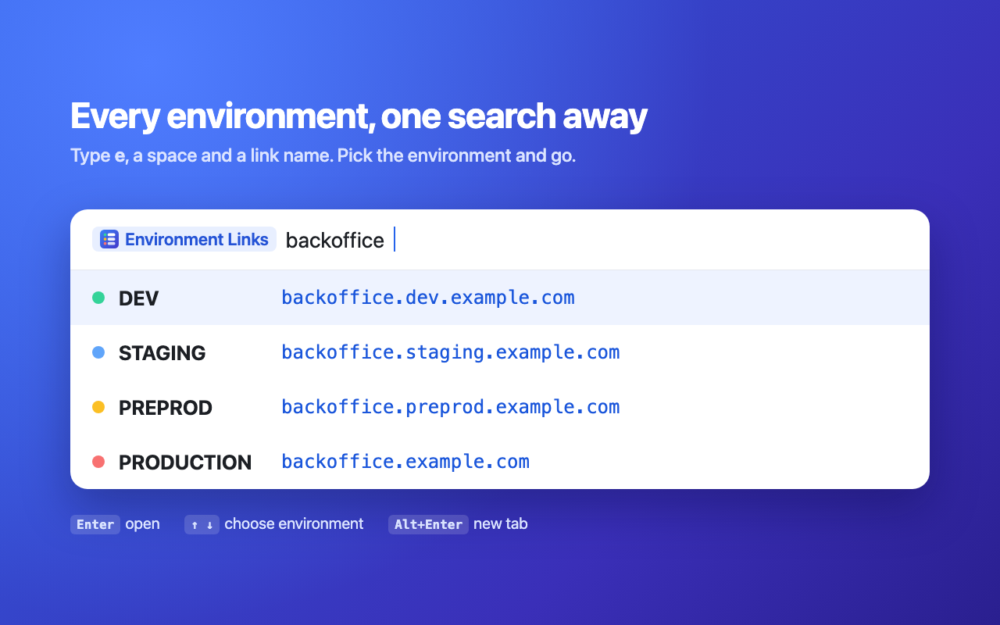

# Environment Links

[](https://chromewebstore.google.com/detail/ggliopecghngikmibollhhljadddnbic)
[](https://apps.xontab.com/)

A Chrome extension that opens the same link in any of your environments (dev, staging, preprod, production and so on), from the address bar or the toolbar.



You write each link once as a template, such as `backoffice.{{ENVIRONMENT}}.{{DOMAIN}}`, and set the variables for each environment. Then:

```
e backoffice
  DEV - backoffice.dev.example.com
  STAGING - backoffice.staging.example.com
  PREPROD - backoffice.preprod.example.com
  PRODUCTION - backoffice.example.com
```

## Features

- **Address bar:** type `e`, a space and a link name to get it in every environment, filter by environment, or append a path.
- **Toolbar list:** every link with a button per environment, with a filter box and arrow-key navigation.
- **One template per link:** variables per environment, a Default row for shared values, and per-environment overrides.
- **Environment groups:** separate setups for different purposes, such as one per product, each with its own variables, environments, links and Shared links. Every group is searched together.
- **Team sharing:** pull a shared set of links, environments and variables from a JSON file in a GitHub repository. Your own settings still win.
- **Portable:** settings sync through your Chrome profile, and you can export and import them as a JSON file.
- **Private:** no analytics and no servers. The only network requests go to GitHub, for Shared links you add.

## Install

**From the Chrome Web Store:** [add Environment Links to Chrome](https://chromewebstore.google.com/detail/ggliopecghngikmibollhhljadddnbic).

**From source:**

```bash
git clone https://github.com/xontab/environment-links.git
```

1. Open `chrome://extensions` and turn on **Developer mode**.
2. Click **Load unpacked** and pick the cloned `environment-links` folder.
3. The settings page opens with a step-by-step tutorial.

## Use

Chrome only hands address-bar input to an extension after its keyword, so type the shortcut `e`, then `Space` or `Tab`, then:

| You type                         | You get                                   |
| -------------------------------- | ----------------------------------------- |
| `backoffice`                     | the link in every environment             |
| `backoffice prod`                | only environments starting with `prod`    |
| `backoffice dev stag`            | DEV and STAGING                           |
| `backoffice stag /players/123`   | STAGING, with `/players/123` appended     |
| `back`                           | every link whose name contains `back`     |
| `prod`                           | every link, in environments starting with `prod` |
| `stag backoffice`                | the same as `backoffice stag`             |
| `api doc prod`                   | the `api-docs` link in PRODUCTION         |

Words can come in any order. Link names come first, and several words can match parts of one name, so `api doc` finds `api-docs` or `API Docs`; links that match more of the words are listed first. A word that isn't part of a link's name narrows the list by environment (or by group), ignoring case, spaces and dashes, so `preprod` also finds `Pre-Prod` and `EU PREPROD`. A single word that names both a link and an environment, such as `dev` with a `devtools` link, lists the `devtools` link first and then every link in DEV.

`Enter` opens the top suggestion; arrow down to pick another. `Alt+Enter` opens it in a new tab.

## Toolbar button

Click the extension's toolbar icon, or press `Ctrl+Shift+E` (`⌘⇧E` on a Mac), for a list of every link with a button per environment. Type in the box to filter (`back prod` works the same as in the address bar). `↑`/`↓` move between links, `←`/`→` between environments, and `Enter` opens the selected one.

To use a different shortcut, click **Change shortcut** under Behaviour in settings, or go to `chrome://extensions/shortcuts`. If another extension already uses `Ctrl+Shift+E`, Chrome leaves this one unset until you choose a key there.

Turn on **Put this group's links in a tab group per environment** under Environments to keep each environment's tabs together: every link you open from that group joins a tab group named after its environment (DEV, PRODUCTION…), coloured to match (production red, staging yellow, dev green). It's a setting of each environment group, so you can have it for one product and not another. Chrome asks for permission to manage tab groups the first time you turn it on.

A plain click follows the "open in" setting, `Cmd`/`Ctrl`-click or middle-click opens a background tab, and `Shift`-click a new tab. **Settings** at the bottom of the list opens the settings page.

## Change the shortcut

The shortcut defaults to `e`. Chrome only reads it from `manifest.json`, so it can't be changed from the settings page. To change it:

```bash
npm run keyword -- go
```

Then click reload on the extension in `chrome://extensions`.

## Configure

- **Environment groups**: Environments, Links and Shared links sit under a row of tabs, one per group, and show the group whose tab is picked. Add a group with **New group**, rename or delete one from its tab's ⋯ menu, and drag the tabs to reorder them (or press Alt+←/→ on a tab, or use Move left/right in the menu). Search results list groups in this order. For example, one group could be `PAM` with DEV, STAGING and PRODUCTION, and another `Payments` with QA, UAT and LIVE. The address bar and toolbar list search every group and label results with the group's name; typing a group's name narrows them to it (`e backoffice payments live`). With tab groups on, tabs are grouped as "LIVE · Payments". With only one group, none of this shows. Behaviour and Import / Export cover every group.
- **Environments**: a grid with one row per environment and one column per variable, so it grows downwards as you add environments. The **Default** row applies to any environment that leaves its cell blank, so `DOMAIN` only has to be set once. Drag the ⋮⋮ handle on a row or column to reorder environments or variables, or focus the handle and use the arrow keys.
- **Links**: a name (what you type) and a template such as `backoffice.{{ENVIRONMENT}}.{{DOMAIN}}`. `https://` is added when no scheme is given. Expand a link to preview each environment's URL and to override it for one environment, e.g. production as `backoffice.{{DOMAIN}}`. If a link doesn't exist in an environment, untick **Applicable** on that environment's row and it's left out of the address bar, toolbar list and tab groups for that link. In a shared file this is `"excluded": ["production"]` on the link.
- **Basic auth**: put a user and password before the host, as in `{{USER}}:{{PASS}}@grafana.{{DOMAIN}}`, and Chrome signs in with them when it opens the link. Values filled in there are encoded, so a password with `@`, `:` or `#` still works. Passwords are hidden as `••••` in previews, the toolbar list and address-bar suggestions, and a variable named like `PASS`, `SECRET`, `TOKEN` or `API_KEY` shows as dots in the grid until you edit it. They're stored like the rest of your settings: synced through your Chrome profile and included in exports, so prefer a read-only or low-privilege account.
- **Import / Export**: **Export to file** saves your settings as a JSON file (without access tokens), marked with its `formatVersion`. Files exported by older versions still import; a file from a newer version asks you to update the extension first. To load it back, drop the file onto the import box (or paste its JSON there), check it, and click **Import from text**.

## Share links with your team

Put a JSON file in a GitHub repository, then add it under **Shared links** in settings with `owner/repo`, or paste the file's github.com link. To build the file, open **Create a shared file from your links**, pick the links to share and commit the JSON as `environment-links.json`.

A shared file feeds the environment group it was added to, and holds that one group's settings. Every field is optional, but it needs `links` or `environments`:

```json
{
  "links": [
    { "key": "grafana", "template": "grafana.{{ENVIRONMENT}}.{{DOMAIN}}", "overrides": { "production": "grafana.{{DOMAIN}}" } }
  ],
  "variableNames": ["ENVIRONMENT", "DOMAIN"],
  "globals": { "DOMAIN": "example.com" },
  "environments": [
    { "id": "dev", "name": "DEV", "variables": { "ENVIRONMENT": "dev" } },
    { "id": "production", "name": "PRODUCTION", "variables": {} }
  ]
}
```

How Shared links combine with your own settings:

- Your own links come first. A shared link with the same name as one of yours is ignored and marked **Overridden**. To change a shared link, click its pencil (**Override**) button: it copies the link into your own links, where your copy is used instead. To go back to the shared one, click the restore (↺) button next to **Overridden**, or delete your copy.
- Environments match on `id`. Shared environments you don't have are added to the end, marked "shared".
- For each variable, the lowest-priority value is listed first: shared default, your default, shared environment value, your environment value. Blank cells in the grid show the value they'll use.
- With several files, the first in the list wins.

Files are fetched through GitHub's API (`api.github.com`) when Chrome starts, every hour, and with **Sync now**. Chrome asks for access to GitHub the first time you add a file. For a private repository, add a fine-grained token with read-only **Contents** access to that repository. Tokens stay on that computer: they aren't synced or exported. If a sync fails, the last good copy is kept, and the error is shown under Shared links with how long ago that copy synced. The group's tab and the toolbar icon both show a red **!**, and the toolbar list starts with a note saying which file. Hover any of them to see what went wrong; click the **!** on the tab, or **Show** in the toolbar list, to go to that file under Shared links.

Settings live in `chrome.storage.sync`, so they follow your Chrome profile across machines (Chrome caps a synced item at about 8 KB, which is a few hundred links).

## Develop

See [CONTRIBUTING.md](CONTRIBUTING.md) for how the code fits together, the store images and releases.

There are no dependencies to install. You only need Node.js 20 or later, for the tests and scripts.

Run the unit tests:

```bash
npm test
```

Build `environment-links.zip` for the Chrome Web Store, or to share for "Load unpacked":

```bash
npm run package
```

Bump the version (`patch`, `minor`, `major` or an exact `x.y.z`) in `manifest.json` and `package.json` together:

```bash
npm run bump -- patch
```

Build a signed `.crx`:

```bash
npm run crx
```

Re-render the icons and store images from `store/source/` (needs Google Chrome):

```bash
python3 scripts/build-assets.py
```

`npm run crx` builds a signed `dist/environment-links.crx`. The signing key lives at `~/.environment-links/environment-links.pem`, outside the project, so it never ends up in the extension. Set `KEY=` to use another path. Back it up: every release must be signed with the same key to keep the extension ID.

`src/core.js` holds the template, search and shared-file merge logic and has no Chrome dependencies. `src/shared.js` fetches shared files from GitHub and caches them, `src/background.js` wires everything to the omnibox and the hourly sync, `src/popup.*` is the toolbar list and `src/options.*` the settings page.

## License

[MIT](LICENSE). Made with ❤️ by [xonTAB](https://xontab.com/). See [more apps by xonTAB](https://apps.xontab.com/) and the [privacy policy](PRIVACY.md).
